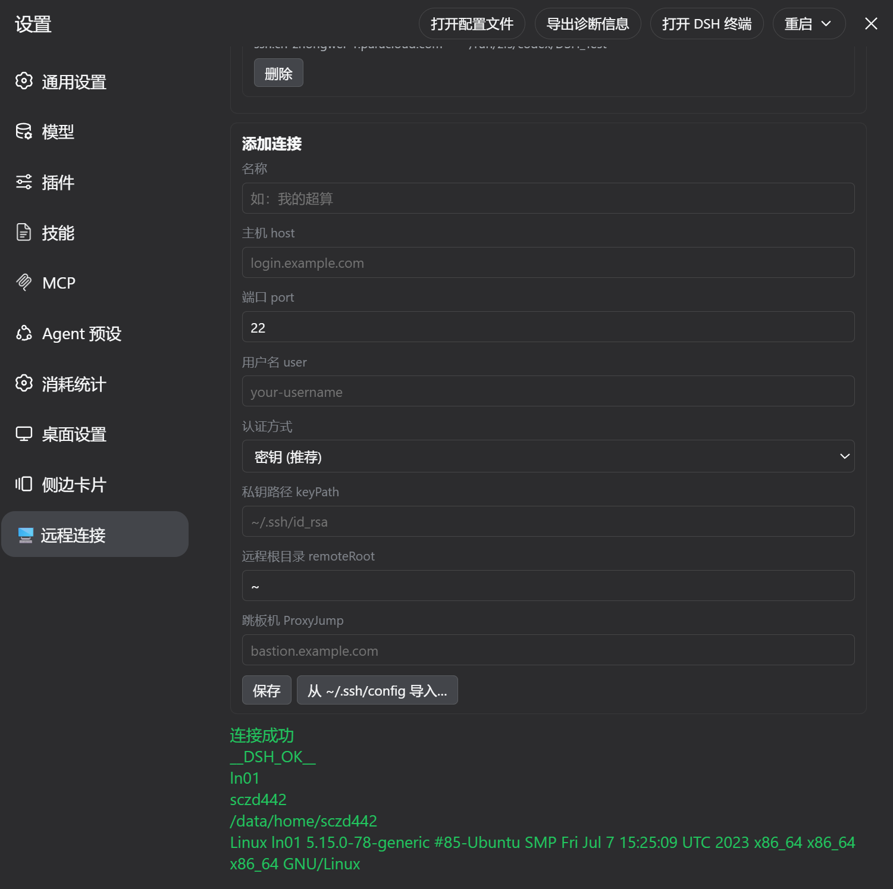
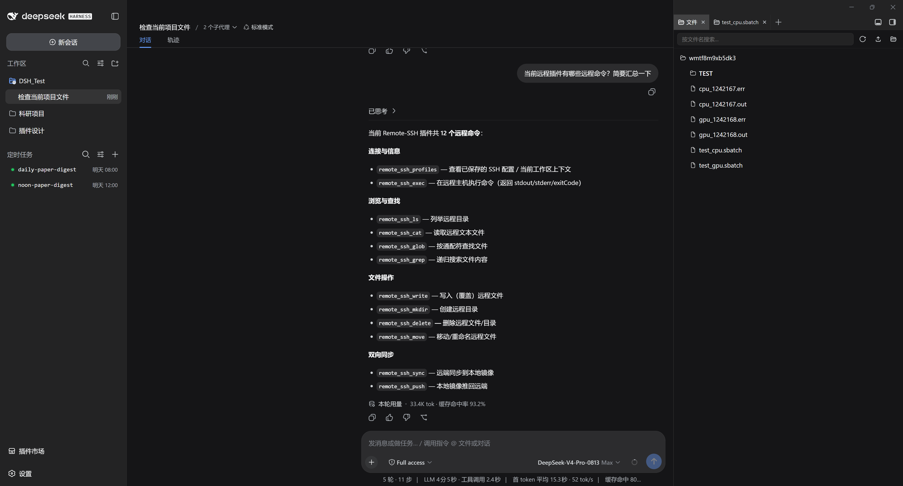
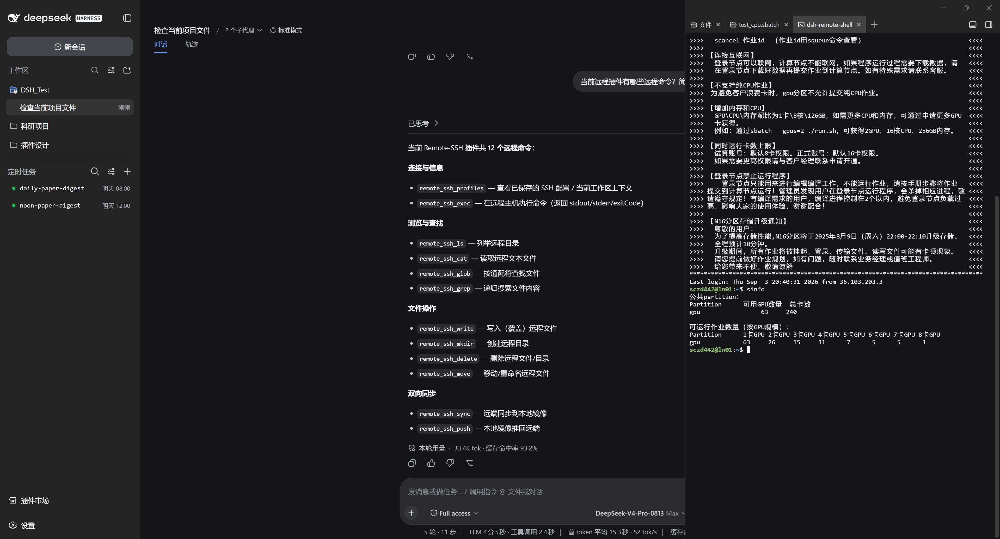

# @zhangfengshun/dsh-remote-ssh

English | [中文](./README.md)

A **DSH** plugin like **VSCode Remote-SSH**: connect to remote HPC / servers via SSH, and directly operate remote files and terminals within DSH's built-in **Files** and **Terminal** sidebar tabs.

**Contents**: [Features](#features) · [Screenshots](#screenshots) · [Installation](#installation) · [Usage](#usage) · [Examples](#examples) · [Model Tools](#model-tools) · [Command Timeout & Recovery](#command-timeout--recovery) · [Compatibility](#compatibility) · [Troubleshooting](#troubleshooting) · [How It Works](#how-it-works) · [Caching & Consistency](#caching--consistency) · [License](#license)

## Features

| Feature | Description |
| --- | --- |
| 🔌 SSH Connection | Key / password auth, ProxyJump bastion, one-click import from `~/.ssh/config` |
| 📂 Remote Files | Built-in **Files** tab reads/writes remote files directly via SSH — no sync needed |
| 💻 Remote Terminal | Built-in **Terminal** tab auto-detects remote workspaces, opens an SSH interactive shell **in the workspace's remote directory** (like VSCode Remote-SSH) |
| 🌐 Remote Workspace | Select a remote directory to create a native workspace, one-click enter |
| 🤖 Model Tools | 13 `remote_ssh_*` tools, session-aware with auto-filled connection params; command-level timeout + `remote_ssh_kill` recovery |
| 🗂️ `@` Completion | In a remote-workspace session, `@` completion lists **remote** files (git repos via `git ls-files`, measured 0.1s; bounded `find` otherwise; cached index + 900ms query budget so the caret never stalls) |
| ⚡ Faster Opens | Single-roundtrip merged reads + raw text fast path + result cache (LRU + 5s TTL): first open ≈**1.31×**, repeat opens within TTL **0 round-trips**, expired revalidation **≈5×** (measured on a real HPC); `remote_ssh_exec` connection reuse **≈15×** |

## Screenshots

**Settings → Remote SSH**: connection profiles (key / password / ProxyJump bastion) · connection test · one-click import from `~/.ssh/config`

<p align="center"></p>

**Built-in Files tab**: browse the remote host directly (the right-hand tree IS the remote directory, edits save back to remote)

<p align="center"></p>

**Built-in Terminal tab**: auto-SSH to the HPC (SLURM environment shown); the left panel shows the model calling `remote_ssh_*` tools without connection params

<p align="center"></p>

## Installation

**Prerequisites**

| Item | Requirement |
| --- | --- |
| DSH | ≥ 0.1.5-rc.1, **0.2.0-rc.1 included** (the current official line; on the 0.1.2 stable line, use the v0.18.1-era plugin release). The declared peer range names every verified line explicitly, so the new harness compatibility gate (see [Installation](#installation)) does not block it |
| dsh-better-sidebar | ≥ 0.15 (this plugin uses its `/sidebar/api/` file API plus 0.24's `open.external` "open with" endpoint; **adapted since 2.4.18**). **This plugin can be installed on its own**: since 2.4.18 a missing better-sidebar no longer stalls web boot (see below), but the remote file tree/editor tab is unavailable without it |
| Local SSH client | Windows: built-in OpenSSH (`%SystemRoot%\System32\OpenSSH\ssh.exe`); Linux/macOS: openssh-client |
| Remote host | Any standard sshd (HPC / server / bastion) |

**One command** (no token, API key or extra configuration needed):

```bash
dsh plugin --profile <name> add @zhangfengshun/dsh-remote-ssh@2.4.30
```

**Restart DSH** after installation. `@zhangfengshun/dsh-remote-ssh` must come **after** `dsh-better-sidebar` in the bundles list.

> **Installing this plugin without `dsh-better-sidebar` (or if that bundle fails to load)?** Since 2.4.18 it starts cleanly: the client half declares only core services (`slots`/`locale`) as hard dependencies and reaches better-sidebar through a **child-fiber soft inject** — the remote file editor tab registers when it is present and is silently skipped when it is not. What still works: the settings "Remote connections" section (connections + remote workspaces), the model tools (`remote_ssh_*`), remote terminal integration and `@` remote file completion. What does not: the Files tab's remote read/write and the editor tab — that `/sidebar/api/fs.*` channel belongs to better-sidebar (the built-in sidebar uses its own `/api/*`, which this plugin does not take over). Older releases stayed **pending forever** in that setup, so the frontend reported `web boot: 1 entry did not activate` / `pending (waiting for service: betterSidebar)` (issue [#18](https://github.com/ZhangFengshun/dsh-remote-ssh/issues/18)). The host also logs `patch: entry "better-sidebar" not found` when that bundle is absent — `dsh-app-boot` warns unconditionally about missing patch targets, **which is expected and harmless**.

> **On DSH 0.2.0-rc.1+, does the install get refused or the plugin stay invisible?** The new harness judges compatibility from the **DSH peer version ranges a plugin declares**: if the range does not cover the running version, installation/activation is **rejected** (`Plugin … is incompatible with dsh <version>`) and the plugin manager offers a per-version "accept the risk" exemption instead. Since 2.4.16 this plugin lists every verified line explicitly (`^0.1.0-rc.6 || ^0.1.5-rc.1 || ^0.1.7-rc.2 || ^0.2.0-rc.1`), so **no exemption is needed**. If you are on an older plugin version, upgrade rather than clicking "accept the risk". (The check is strict semver: a prerelease runtime is only covered by a range that names that line explicitly — which is why lines like `0.1.5-rc.1` are listed one by one.)

Uninstall:

```bash
dsh plugin --profile <name> remove @zhangfengshun/dsh-remote-ssh
```

> ⚠️ **dsh-better-sidebar compatibility (measured 2026-09)**: `0.18.1 / 0.19.0 / 0.19.1` cannot load their host half on DSH Desktop v2.0.9 (DSH 0.1.5-rc.1) — they value-import `SessionLogOffset`, which the desktop module surface exposes only as a type — so the sidebar Files tab falls back to "Nothing here can view this kind of content yet." Use **0.18.0** or a build carrying the fix; this plugin supports both contracts (4 endpoints on 0.18, 6 including `fs.rename`/`fs.remove` on 0.19).

## Usage

**Three steps**

1. **Settings → Remote SSH** → Add a connection (host / port / user / key) → Click "Test Connection"; an existing `~/.ssh/config` can be imported in one click
2. **Add Workspace** → Choose "Select Remote Directory…" → Pick a connection → Browse and select a remote directory (it becomes a native DSH workspace); if the directory does not exist yet, click "📁 New folder" to create it in place (both the local and remote tabs) — the picker then enters it automatically
3. Inside that workspace session: the built-in **Files** tab shows remote files (edits save straight back to remote), and the **Terminal** tab auto-SSHes **into the workspace's remote directory** (key auth only)

**Just ask the model** (connection params are auto-filled inside a remote-workspace session):

```text
What's inside /home/user/project? Then fix line 20 of train.py
Run squeue -u $USER and summarise the queue as a table
Grep every ERROR line from the *.log files in this directory
```

## Examples

**1 · Run a remote command** (`remote_ssh_exec`, 120s timeout by default):

```json
{
  "command": "sinfo -h -o '%P %a %D %t %N' | head -20",
  "timeoutMs": 30000
}
```

Returns `{ ok, exitCode, stdout, stderr, error, truncated, isTimeout }` — e.g.

```json
{ "ok": true, "exitCode": 0, "stdout": "cpu* up 12 idle 8 ...\n", "stderr": "", "error": "", "truncated": false, "isTimeout": false }
```

**2 · Read / write files (no sync needed)**:

```json
{ "path": "~/project/config.yaml", "content": "lr: 0.001\nepochs: 50\n" }
```

```json
{ "path": "~/project/train.py" }
```

`remote_ssh_cat` transfers base64 (binary-safe); `remote_ssh_write` is atomic (temp file + rename).

**3 · Long jobs and hung-command recovery**:

```json
{ "command": "cd ~/project && bash run_train.sh", "timeoutMs": 0 }
```

```json
{ "all": true }
```

`timeoutMs: 0` disables the timeout for that call; `DSH_REMOTE_SSH_CMD_TIMEOUT_MS=600000` changes the global default. Timed-out pooled sessions are discarded and rebuilt, and `remote_ssh_kill` is the manual hatch.

**4 · Tool calls inside a remote workspace** (`profileId` omitted, relative paths resolve against the remote root):

```json
{ "path": "configs/exp1.yaml" }
```

**5 · Import connections from `~/.ssh/config`**: Settings → Remote SSH → "Import SSH config" → tick hosts → host / user / port / keyPath / ProxyJump are filled in.

**6 · Mirror sync and push-back** (review offline, then upload in one shot):

```json
{ "workspaceId": "w_xxx" }
```

```json
{ "workspaceId": "w_xxx" }
```

`remote_ssh_sync` pulls the remote tree into the local mirror; `remote_ssh_push` sends mirror changes back (tar over ssh, batched).

**Since 2.4.20 sync is a guarded whole-tree operation.** The order is fixed: *size sentinel → extract into a temp directory → (whole-tree) compare "mirror-only files" → atomic swap*. If any step fails, the old mirror is left untouched.

| Parameter | Effect |
| --- | --- |
| `paths` | Only sync these sub-paths (relative to the remote root), e.g. `["src","docs"]`. **A partial sync only overwrites those sub-paths and deletes nothing else in the mirror.** |
| `exclude` | Exclude rules (relative to the remote root, `*` supported), pushed down as `tar --exclude=./x`, e.g. `["data","*.log"]` |
| `force` | Explicit confirmation: skip the size sentinel and the mirror-only-file guard (only when you really mean a whole-tree copy) |
| `maxBytes` | Size limit for this sync, overriding the workspace setting and the **2 GiB** default |
| `timeoutMs` | Wall-clock budget for this sync, **10 minutes** by default (0 = unlimited) |

```json
{ "workspaceId": "w_xxx", "paths": ["src"], "exclude": ["data", "*.log"] }
```

- **Size sentinel**: before deleting anything it runs `du -sb -c -- <this scope>` (15 s budget, only the scope being synced). Over the limit, probe timeout, no `du` on the remote, unparsable output — **all refused**, requiring an explicit `force: true`. Default 2 GiB (`syncMaxBytes` field or `DSH_REMOTE_SSH_SYNC_MAX_BYTES`).
- **Mirror-only files are never deleted silently**: before a whole-tree swap the old mirror is compared with the pulled result; if files exist locally that the remote does not have, the sync is refused with a list (up to 20), telling you to either `remote_ssh_push` them first or retry with `force: true`. The plugin's own `.remote-ssh.json` and placeholder `README.md` are recognised by content fingerprint and excluded from the list.
- **`push` no longer pollutes the remote root**: `.remote-ssh.json` (connection details) is always excluded, as is the plugin's placeholder `README.md` — a `README.md` you wrote yourself is untouched.
- ⚠️ **`exclude` does not filter paths listed explicitly in `paths`** (tar does not apply `--exclude` to command-line members): to drop a large directory, list its parent in `paths` so the directory becomes a member rather than a target. Also note that an exclude pattern matching nothing is **neither an error nor a warning** (tar semantics), so "I passed an exclude and nothing happened" is not evidence that the option was dropped.
- **The mirror is an outbound buffer, not a remote snapshot**: the agent's `write` updates both the mirror and the corresponding remote file, and `remote_ssh_push` is the channel that carries such changes back. To read the current remote content inside a session use the Files tab or `remote_ssh_cat` — the mirror may be stale.
- **Write-back bridge (issue #24)**: after `write`/`edit` lands in the local mirror, the same content is pushed to the remote. Since 2.4.24:
  - **content over 4 MiB is pushed too** (chunked base64 appends plus a remote byte-count check) — previously this failed deterministically with only a log line, so the model assumed the remote already had the file;
  - **a failed push is reported as an error** stating that the local mirror write succeeded and pointing at `remote_ssh_push`. Restore the log-only behaviour with `writeBackFailure: "log"` (or `DSH_REMOTE_SSH_WRITEBACK_FAILURE=log`) — **since 2.4.26** that mode also writes guard B's full remedy report to the log (it used to log one short line, i.e. "report instead of push" with no report at all);
  - **keep drafts off the remote** with a per-workspace `writeBack: false`, or exclude paths via `writeBackExclude` (mirror-relative, `*` / `**` / `?`, trailing `/` = directory prefix), e.g. `["_patch/**", "*.log"]`.
  - **Guard B (since 2.4.25, on by default) — look before you push**: after a successful push the plugin records the remote's `size:mtime` (`~/.dsh/remote-ssh/writeback-mtimes.json`); before pushing the same path again it re-checks and, **if the remote changed or the file is gone, it does not push** and reports an error saying the local mirror write succeeded, pointing at `remote_ssh_sync` (pull and compare) and `remote_ssh_push` (overwrite deliberately). On a shared cluster the most common "other writer" is **your own finished job** — this is exactly the "job updated the remote, mirror was stale, agent overwrote it" case.
    - The comparison happens **only on the remote's own timeline** (never remote-vs-local mtime: clock skew and tar/base64 rewrites make the two incomparable). **Unreadable ≠ changed**: a failed `stat` or a flaky ssh connection counts as "unknown state" and the push proceeds with a log line.
    - Records are cleared after an explicit remote write (`remote_ssh_write`, Files-tab save) and after a successful `remote_ssh_push` / `remote_ssh_sync` (mirror and remote agree again) — which is also the documented way out when guard B blocks you.
    - **Turn it off** with `writeBackFreshness: false` or `DSH_REMOTE_SSH_WRITEBACK_FRESHNESS=off` (back to unconditional overwrite).
  - **All of these are reachable in the settings panel** (since 2.4.25): Settings → this plugin → "Write-back & terminal (advanced)" holds `nodePath` / `writeBackFailure` / `writeBackFreshness`, and each remote workspace has its own "enable write-back + write-back excludes" controls.

## Model Tools

| Tool | Purpose |
| --- | --- |
| `remote_ssh_profiles` | List saved connections + current session's remote workspace context |
| `remote_ssh_exec` | Execute remote command (default 120s command timeout; `timeoutMs` to relax/disable) |
| `remote_ssh_kill` | Force-close pooled SSH sessions (recovery for hung commands) |
| `remote_ssh_ls` | List remote directory |
| `remote_ssh_cat` | Read remote file |
| `remote_ssh_write` | Write remote file |
| `remote_ssh_grep` | Search remote file contents |
| `remote_ssh_glob` | Find remote files by glob |
| `remote_ssh_mkdir` | Create remote directory |
| `remote_ssh_delete` | Delete remote file/directory |
| `remote_ssh_move` | Move/rename |
| `remote_ssh_sync` | Sync remote to local mirror (**whole tree**: narrow it with `paths`/`exclude`, oversized roots are refused, mirror-only files are never deleted silently) |
| `remote_ssh_push` | Push local mirror back to remote (the plugin's own `.remote-ssh.json` and placeholder `README.md` are always excluded) |

In a remote-workspace session, `profileId` and other connection params can be omitted. All file/command tools run over the persistent SSH session pool + result cache; `remote_ssh_exec` measures ≈15× faster per command.

## `@` File Reference Completion

In a remote-workspace session, typing `@` offers **remote** candidates (matching the Files tab tree) instead of the local mirror directory:

- **Index source**: git repos use `git ls-files --cached --others --exclude-standard` (respects `.gitignore`, includes untracked files; measured 0.117s / 137 entries on a real HPC), non-git directories fall back to a bounded `find` (`maxdepth 5` + pruning, measured 1.57s / 3121 entries);
- **Exclusion happens remotely, before truncation** (fixed in 2.4.8): `git ls-files --cached --others` output is **not globally sorted** (untracked files come first in readdir order), so a `node_modules/` tree can fill the first 20,000 lines and exhaust the quota — the excluded directories are therefore filtered by a remote `grep -vE` *before* `head` (same source of truth as the `-prune` list), with the client-side filter kept as a second line of defence; hitting the index cap now logs a warning that files may be missing;
- **Query semantics mirror the official provider**: `@` and `@src/` list a remote directory; `@read` runs the fuzzy index (exact name > prefix > name substring > path substring > subsequence, directories +25);
- **The caret never stalls**: the index is cached per workspace for 60s (invalidated after writes/commands) and a single completion waits at most 900ms — on timeout the stale index answers and the rebuild continues in the background; connection failures fall back to local behaviour;
- **Local workspaces are untouched**: non-remote sessions delegate straight to the host implementation.

## Command Timeout & Recovery

All SSH commands default to a **120-second** timeout (issue #5): a hung remote command (network stall, stuck remote process, `cat` waiting on stdin) can no longer occupy the session forever and block every later command.

- **Automatic recovery on timeout**: the pooled session is discarded and rebuilt automatically, so subsequent commands keep working; one-shot connections terminate the SSH process;
- **Explicit budgets**: `remote_ssh_exec` accepts `timeoutMs` (milliseconds) per call, `0` disables the timeout (long builds/training); the `DSH_REMOTE_SSH_CMD_TIMEOUT_MS` environment variable overrides the global default;
- **Manual hatch**: `remote_ssh_kill` (or `all: true`) force-closes one or all pooled sessions at any time;
- Timed-out commands are **never auto-retried** (retrying a hung command just hangs again) — the model decides whether to kill the session or retry differently.

## Compatibility

**Measured matrix** (2026-09-12, all verified on real machines):

| Component | Version | Status |
| --- | --- | --- |
| DSH | 0.1.5-rc.1 (DSH Desktop v2.0.9) | ✅ host services / settings / tools / slots / upload & download interception all compatible |
| DSH | **0.2.0-rc.1** (DeepSeek Harness desktop nightly, 2026-09-28) | ✅ adapted and verified on a real runtime since 2.4.16: the peer range names that line explicitly (otherwise the harness **refuses to install/activate** the plugin); the new `settings` API and the legacy-data migration keep working (a fresh profile restores every connection and workspace on its first boot); the terminal patch still lands on `terminal-controller`. The client inject list drops `dsh-client-runtime`, which the runtime no longer ships; 2.4.17 fixes the invisible workspace globe badge on a light theme (its colour now follows the icon's computed colour) |
| DSH | **0.1.7-rc.2** (DSH Desktop v2.0.15) | ✅ since 2.4.15: the new `settings` API (`configure`/`describe`/`update`, data stored in this plugin's entry Config with `.volatile()` fields) plus a **one-time migration of the retired `settings.yaml`** (connection/workspace ids and mirrorPaths preserved — nothing to rebuild); the sidebar terminal is now owned by the host's native `terminal-controller`, and the bundle patch covers it as well as `better-sidebar` |
| DSH | 0.1.5-rc.1 / 0.1.0-rc.6 lines | ✅ host services / settings / tools / slots / upload & download interception all compatible (still covered by the peer range) |
| DSH | 0.1.2-rc.1 stable line | ✅ (the 2.3.x-era baseline) |
| dsh-better-sidebar | 0.15.0 – 0.18.0 | ✅ `fs.tree`/`fs.read`/`fs.write` + `fs.search` (the `{ matches: cwd-relative '/'-separated paths, truncated }` contract, since 2.4.11; returning only `entries` used to crash the whole Files tab on search) |
| dsh-better-sidebar | 0.19.x | ⚠️ this plugin already supports the 6-endpoint contract (incl. `fs.rename`/`fs.remove`); 0.19.0/0.19.1 themselves cannot load their host half on DSH Desktop until upstream fixes it (see the warning under [Installation](#installation)) |
| dsh-better-sidebar | **not installed / failed to load** | ✅ **boots normally since 2.4.18** (no more `web boot` block, see [Installation](#installation)): the settings "Remote connections" section, model tools, remote terminal and `@` completion keep working; ⚠️ the Files tab's remote read/write and the editor tab are unavailable (`/sidebar/api/fs.*` belongs to better-sidebar; the built-in sidebar uses its own `/api/*`). The host logs a `patch: entry "better-sidebar" not found` warning, which is expected |
| Remote sshd | standard OpenSSH (Linux / HPC / Windows) | ✅ key auth; password auth needs `sshpass` on the host (POSIX) |

The plugin never patches DSH sources or injects into the profile dependency tree — everything mounts through the official `cordis.patch.yml` + profile mechanism.

## Troubleshooting

| Symptom | Cause and fix |
| --- | --- |
| "Test Connection" reports `Permission denied (publickey)` | ① key has a **passphrase**: the plugin runs in batch mode (`BatchMode=yes`) and cannot prompt — load it with `ssh-add` first, or strip the passphrase; ② on a Windows host where the user is in Administrators, the public key must go to `C:\ProgramData\ssh\administrators_authorized_keys`; ③ the username spelling (`user` / `.\user` / `user@domain`) must match a manual connection |
| Key auth fails after launching `dsh web` from git-bash | Fixed in 2.3.9: on Windows the ssh binary is pinned to the system OpenSSH absolute path (previously Git's MSYS2 ssh was picked up) |
| Sidebar Files tab says "Nothing here can view this kind of content yet." | `dsh-better-sidebar` host half failed to load: 0.18.1 / 0.19.0 / 0.19.1 hit the `SessionLogOffset` runtime import on DSH Desktop — downgrade to 0.18.0 or use a fixed build (upstream PR [#641](https://github.com/omdsh-dev/DSH-better-sidebar/pull/641)) |
| The frontend shows `Failed to load plugins` / `web boot: 1 entry did not activate` / `@zhangfengshun/dsh-remote-ssh: pending (waiting for service: betterSidebar)`, and Desktop offers plugin recovery | Known issue up to 2.4.17 (issue [#18](https://github.com/ZhangFengshun/dsh-remote-ssh/issues/18)): the client half declared better-sidebar's service as a **hard dependency**, so without that bundle the entry stayed pending forever (a cordis fiber does not activate while any injected key is missing). **Upgrade to 2.4.18**, or install `dsh-better-sidebar` (matching your harness line) and restart |
| Built-in Terminal tab cannot connect | The terminal is an `ssh -tt` interactive channel and supports **key auth only**; password-auth profiles fall back to a local shell and now print a one-line notice (so a local shell is not mistaken for a remote one) — use the Files tab and the model tools for password auth |
| "Test Connection" reports **`the configured private key file does not exist`** (or the raw output shows `Warning: Identity file … not accessible`) | Since 2.4.19 this is called out first: the `keyPath` of the connection points at a private key file that does not exist on this machine (typo, key not synced to a new machine, or `~` not resolving there). Point `keyPath` at the right file, or **clear `keyPath`** to rely on ssh-agent / `IdentityFile` from `~/.ssh/config`. Note that Test Connection runs in batch mode and cannot prompt for a passphrase (run `ssh-add` first) |
| The server asks for **QR-code / one-time-password / 2FA** (`keyboard-interactive`) and Test Connection still fails | Test Connection and all file/tool capabilities use the **non-interactive public-key channel** (`BatchMode=yes` + `PreferredAuthentications=publickey`), so no QR prompt is ever shown — that is deliberate (batch, concurrent and unattended calls cannot wait for a human scan). **Use the built-in Terminal tab for interactive logins** (`ssh -tt`, no BatchMode: QR codes, passwords and OTPs all work there); to make file/tool capabilities work, add this machine's public key to the remote `~/.ssh/authorized_keys` (a `Permission denied (publickey,password,keyboard-interactive)` line only means the server *offers* those methods — it does not mean this plugin can use them) |
| Terminal opens in the remote `$HOME` instead of the workspace directory | Fixed in 2.4.5 (the wrapper `cd`s into the workspace `remotePath`, falling back to `$HOME` when it no longer exists); if it still starts in `$HOME`, make sure 2.4.5 is installed and DSH restarted |
| Files tab tree root shows the mirror directory id (e.g. `wmirror3`) | Fixed in 2.4.6: the root row now shows the **remote directory name** (e.g. `my-project`) with the full remote path on hover; that label never passes through the `fs.*` routes, so the client renders the replacement |
| `@` completion only finds the few files in the mirror | Fixed in 2.4.7: in a remote-workspace session `@` now lists remote files (60s index cache + 900ms query budget); if only mirror files show up, make sure 2.4.7 is installed and DSH restarted |
| In a large repo `@` cannot find real files (e.g. root `AGENTS.md`, `src/**`) | Fixed in 2.4.8: exclusion used to run *after* truncation, so a `node_modules/` tree could exhaust the index quota; exclusion now happens remotely (`grep`/`-prune`) before truncation, and hitting the cap logs a warning |
| The remote directory you want does not exist yet and "Add Workspace" cannot create it | Fixed in 2.4.9: the directory picker has a "📁 New folder" button (both tabs) — type a name to create it in place and enter it automatically |
| Accessing from the LAN / another device makes every file capability return 403 | Fixed in 2.4.10: the trust fence now reads the host's `ctx.webRuntime.trustedHosts` (same source as the `/api` gateway). Add the address to the DSH trust list — start with `--trusted-host <host[:port]>`, or access through your paired remote-access setup; with nothing configured the behaviour is unchanged (loopback only) |
| The Files tab's "search by file name" crashes with `Cannot read properties of undefined (reading 'length')` | Fixed in 2.4.11: the `fs.search` interception returned only `entries`, while better-sidebar's client contract is `{ matches, truncated }`; it now provides `matches` (cwd-relative, `/`-separated, matching upstream's own implementation) and keeps `entries` |
| "Search by file name" spins forever in a remote workspace (large trees) | Fixed in 2.4.11: shallow-first (`-maxdepth 3`, measured 0.68s cold / 0.11s warm) **returning as soon as anything matches** (the deeper pass becomes a background cache warm-up and only runs synchronously when the shallow pass finds nothing), noise directories pruned before traversal, the short-circuit-blocking `sort` removed, and a remote wall-clock budget that returns the **partial results collected so far** and flags them as incomplete. Measured on an 大型项目 workspace: 5 minutes with zero output before → **43 matches in 0.96s** now |
| In a remote session `@filename` shows no candidates, while a bare `@` works | Fixed in 2.4.11: fuzzy queries rely on the index, and the index preferred `git ls-files --cached --others` (`--others` must walk the whole working tree and never finishes on huge projects → empty index). It now degrades in three budgeted steps (full git 6s → index-only git 3s → bounded `find` `maxdepth 3` + 5s) and falls back to a bounded `find` (measured 0.65s) whenever the index is not ready yet, so candidates are never empty |
| Install right after a release fails with `minimumReleaseAge` / `ERR_PNPM_MINIMUM_RELEASE_AGE_VIOLATION` / "No matching version" | Two layers of supply-chain freshness policy: ① **npm metadata propagation** (usually 1–5 minutes — if `npm view` cannot see the new version yet, this is the layer); ② the **DSH Desktop plugin manager installs with pnpm**, whose `minimumReleaseAge` window is **24 hours in practice** — for about a day after a release the manager refuses to install it (see `<profile>/.plugin-manager/logs/*/pnpm.log`, which prints the cutoff). Retry once the window has passed. **To install immediately**, add the package **name** to `minimumReleaseAgeExclude` in `<profile>/pnpm-workspace.yaml` — measured on pnpm 11.7: the *resolution* path (installing a version newer than the lockfile) only matches the **name-only** form; the `name@version` form is honoured by the *lockfile verification* alone, so a fresh release still gets `ERR_PNPM_NO_MATURE_MATCHING_VERSION` with a pinned entry |
| **On another computer the remote workspace folder icon has no globe badge that this machine shows** | That badge is a client-side DOM decoration (the shell's workspace rows only expose a fixed folder primitive — there is no per-workspace icon API), so it needs: the client half to be loaded → the host to return remote workspaces → the row text/attributes to match the workspace title → the shell DOM to be unchanged → **the badge colour to be visible in that theme**. Since 2.4.17 the colour is taken from the folder icon's own computed colour (visible in light and dark themes; it used to be a hard-coded white that was **invisible on a light theme**), matching normalises whitespace and also accepts `title`/`aria-label`, and a self-check was added. **Diagnose** by running `window.__dshRemoteSshGlobeStats(true)` in the devtools console: `undefined` means the client half did not load (upgrade the plugin and hard-refresh the page); `remoteWorkspaces: 0` means the host returned no workspaces (check plugin/harness compatibility); `remoteWorkspaces > 0` with `globesInDom: 0` means the title or DOM did not match (compare `titleSamples` with what the sidebar actually shows) |
| `remote_ssh_push` / `remote_ssh_sync` report `returned invalid output` even though the push succeeded | Fixed in 2.4.13: their shared output schema marked `error` as required while the success path returned an undeclared `remotePath`/`mirrorPath`, so **only success failed** (failures validated fine). The schema now declares both path fields, `error` is optional, the success paths carry `error: ""`, and every output schema in the file treats `error` as optional |
| Sync refused: "exceeds the sync limit" / "could not confirm the remote size within 15 s" | The **size sentinel** introduced in 2.4.20: it measures before deleting anything, with a **2 GiB** default limit — a code+datasets mixed remote root hits it routinely. Three ways out: (1) `paths: ["src"]` to sync just what you need (recommended); (2) `exclude: ["data"]` to drop large directories; (3) `force: true` if you really want the whole-tree copy. Tune the limit with the workspace `syncMaxBytes` field or `DSH_REMOTE_SSH_SYNC_MAX_BYTES` |
| Sync refused: "will delete N files that exist only in the mirror" | That is the **data-loss guard**: those files (typically writes >4 MiB that never made it back, or a failed push) would vanish in a whole-tree swap. Run `remote_ssh_push` first, or retry with `force: true` to accept the loss. The plugin's own `.remote-ssh.json` and placeholder `README.md` are not counted |
| A sync never returns | Since 2.4.20 sync/push have a wall-clock budget (10 minutes by default, `timeoutMs`, 0 = unlimited); on expiry both ends are terminated and the **old mirror is untouched**. Releases ≤2.4.19 had no timeout and could only be killed |
| **A connection with ProxyJump set: the built-in Terminal tab exits immediately (255, `no argument after keyword "-j"`)** | Fixed in 2.4.21: the terminal wrapper inserted `-J` **between `-o` and its value**, so ssh read `-J` as the keyword of `-o` (lowercased, hence `-j` in the message) and reported "no argument". Upgrade to **2.4.21** and restart DSH (the wrapper is rewritten on every plugin load, so nothing under `~/.dsh/remote-ssh/` needs deleting). Workaround on older versions: clear that connection's ProxyJump (only viable if the target host is directly reachable) |
| **After a push the remote root contains `.remote-ssh.json` / `README.md`, or `exclude` seems to do nothing** | **A 2.4.20 regression, fixed in 2.4.22**: excludes for the *sync* direction must carry shell quotes (they are interpolated into a remote command string), but the same helper was also used for *push*, where the strings are **argv elements** handed to the local tar (no shell) — the quotes became literal pattern characters, so every `--exclude` failed silently, including the two hard-coded ones. Upgrade to **2.4.22** and restart DSH; **if you already pushed**, delete the stray `.remote-ssh.json` and `README.md` from the remote root (same sizes as those files in the local mirror) |
| **On Windows, non-ASCII file names come back mangled after a pull (`报告_2026Q1.csv` → `鎶ュ憡_2026Q1.csv`) while the contents are intact** | **Fixed in 2.4.23 (issue #22)**. Three parties each assumed something different: the remote GNU tar writes short non-ASCII names as a **plain ustar header** (raw UTF-8 bytes in the name field — no PAX record, no charset declaration), while Windows' bundled `tar.exe` (bsdtar 3.8.8) decodes that field using the **local ANSI code page** (CP936 on a Chinese system) — **exit code 0, empty stderr**, only the name rewritten — and that build does not support `--hdrcharset` either. The fix makes the remote emit `--format=pax` (the `path=` record carries the correct UTF-8 name), probed per profile and cached, with **zero size overhead** measured. Upgrade to **2.4.23** and restart DSH. **Mirrors that are already mangled**: do *not* reach for `force: true` (it would discard any edits you made to those copies) — the first whole-tree sync lists the `mangled → correct` pairs; either pass `repairNames: true` to let the plugin clean them up (remote wins), or rename them locally first and `remote_ssh_push` |
| **A sync reports "N suspected legacy mojibake file names"** | Those are not mirror-only files but rewrites left by ≤2.4.22 pulling non-ASCII names on Windows (issue #22). Retry with `repairNames: true` to clean them (a whole-tree sync removes them with the atomic swap; a scoped sync deletes them and prunes the emptied directories). The plugin only removes entries proven to be the GBK rewrite of a correct name that exists on the remote — if any genuinely mirror-only file is present in the list it still refuses, and never deletes a real file under the pretext of a repair |
| **On DSH Desktop the Terminal tab flashes and exits (`'node' is not recognized…`)** | **Fixed in 2.4.24 (issue #23)**. The generated wrapper called a bare `node`, while Desktop **by design** keeps its bundled node off the child PATH (only package operations go through `packageManager`; the bundled runtime exists to be invoked by absolute path). Any machine without node on PATH therefore could not open the terminal at all — nothing to do with SSH, keys or jump hosts. Since 2.4.24 the wrapper bakes in an **absolute** node path (`nodePath` setting → `DSH_REMOTE_SSH_NODE` env → **the interpreter actually running this plugin**, `process.execPath`), falls back to PATH, and otherwise prints an actionable error (naming this plugin, why Desktop has no node, and how to configure it) and exits 127. **Note that the 2.4.24 resolution was too strong a claim for the officially packaged build**: there `execPath` is `DeepSeek Harness.exe`, `DSH_DESKTOP_NODE_EXECUTABLE` is absent from the child environment and no node sits next to it — all five candidates missed (the reporter verified this line by line against the packaged artifacts, issue #23 second round). **Since 2.4.25** there are two more fallbacks: `%DSH_HOME%\dsh-runtimes\*\dependencies\node\bin\node.exe` (`DSH_HOME` being the generic root the host exports) and `<install dir>\resources\runtime\*\dependencies\node\bin\node.exe` (derived from `process.execPath`; a `process.resourcesPath` probe covers the rest). The runtime instance name is **not hard-coded** (`primary` first, then by name) and every candidate must pass `existsSync`; whichever one wins is logged. Upgrade to **2.4.25** and restart DSH (the wrapper is rewritten on every load). If it still fails, the most direct fix is to **type the absolute node path into `nodePath` in the settings panel** (since 2.4.25 that field lives under "Write-back & terminal (advanced)" instead of only in the config file) |
| **`write` / `edit` report success but the remote has no such file (e.g. content over 4 MiB)** | **Fixed in 2.4.24 (issue #24)**. The write-back bridge only logged a host-side warning on failure: ① content over 4 MiB was stopped by `MAX_BYTES` (one log line, CSV or notebook is enough), ② every other failure (dropped ssh, permissions, quota) was equally silent — so the model believed the remote already had the file. Since 2.4.24: content over 4 MiB is **uploaded in chunks** (with a remote byte-count check) and no longer fails; remaining failures are **reported as an error** whose message states that the local mirror write succeeded and points at `remote_ssh_push`. Set `writeBackFailure: "log"` to restore the old log-only behaviour (since 2.4.25 it is a dropdown in the settings panel) |
| **`write` / `edit` fails with "the local mirror was written, but it was NOT pushed to the remote"** | That is **guard B (since 2.4.25, on by default; issue #24 second round)**: before pushing, the plugin found that the remote copy **had changed since the last push** (on a shared cluster usually because your own finished job wrote it), so it reports instead of overwriting — pushing would silently discard those changes. Handle it by pulling the remote down first (`remote_ssh_sync`, or `remote_ssh_cat`) and comparing; if the local copy should win, run `remote_ssh_push` to overwrite (a successful push/sync clears the record, so it will not block you forever). To disable the guard entirely use the `writeBackFreshness` setting or `DSH_REMOTE_SSH_WRITEBACK_FRESHNESS=off`. If the log line instead says the remote state could not be determined, that is a connection problem — in that case the plugin **pushes as usual** and only logs (unreadable ≠ changed). With `writeBackFailure: "log"` the tool does not fail, but **the same full report goes to the log** (since 2.4.26) — do not judge by the tool result alone |
| **Drafts/temporary files written in the session directory are silently published to the remote (shared HPC project dir)** | The write-back bridge mirrors agent `write`/`edit` to the remote (guardrail suggested in issue #24). A workspace can disable it entirely with `writeBack: false`, or exclude paths with `writeBackExclude` — mirror-relative paths supporting `*` / `**` / `?`, with a trailing `/` meaning a directory prefix, e.g. `["_patch/**", "*.log", "scratch/"]`. Both affect **only the write-back**; `remote_ssh_push` can still publish things deliberately |
| **In a local session, "some files won't open": `cannot read: ENOENT …<profile>\tools\x.py`** | **Fixed in 2.4.27 (issue #25)**. To support remote workspaces the plugin takes over better-sidebar's `/sidebar/file` and `/sidebar/api/fs.*` with `exact` routes — and **exact routes capture local sessions too**: the local branch handed relative paths straight to `fs`, so Node resolved them against the **plugin host's `process.cwd()`** (the pnpm profile directory). Relative paths therefore failed with ENOENT while absolute paths worked, which is why it looked like "some files won't open". Writes were worse: `fs.write` / `fs.remove` with a relative path landed **inside the plugin host directory**. Since 2.4.27 every site (`/sidebar/file`, `fs.read/tree/trees/write/rename/remove/mkdir/search` on both the local and remote branches, `git.*`, `open.external`) resolves against the **session cwd** first (same semantics as upstream `ensureWorkspacePath`), and **fails loudly** when no session cwd is available instead of guessing `process.cwd()` |
| **In a remote workspace the file tree's "New file" looks successful but the file never reaches the remote; the git panel's blame / worktrees / pull / push return wrong results or `not a git repository`** | **Fixed in 2.4.28**. better-sidebar **0.25.0** added 9 endpoints, 6 of which touch a repository or a path, and the plugin had not registered them. The plugin takes over `/sidebar/api/fs.*` and `git.*` with `exact` routes, so **unregistered endpoints fall back to the upstream implementation** — whose cwd in a remote workspace is the **local mirror directory**: `fs.createFile` therefore created an empty file only in the mirror (never on the remote; the same class as the `fs.trees` bypass in 2.4.18); `git.blame` / `git.diff-head` / `git.worktrees` computed against the mirror's git state (the mirror usually has no `.git`, so empty results or errors); and `git.pull` / `git.push` ran against that unrelated mirror repository. Since 2.4.28 all six are intercepted and run **on the remote**; the model-only endpoints (`git.models` / `git.suggest-message` / `git.commit-model`) touch no repository path and still belong to upstream. Upgrade to **2.4.28** and restart DSH |
| **In a remote workspace, a file you wrote or deleted never reaches the remote, or you get `400 ENOENT … lstat '<mirror path>'`; sessions started in a **subdirectory** hit this most often** | **Fixed in 2.4.29**. Remote-workspace detection only recognised "the one directory that literally holds `.remote-ssh.json`" (`readRemoteInfoSync` does **not** walk upwards): real clients always send a valid `sessionId` (the session cwd is the mirror root), so this stayed hidden — but it misses when ① the session was started in a **subdirectory** of the workspace, or ② the client sends a **stale/unknown `sessionId`**, in which case detection falls back to the request's `path`. A missed detection makes writes/deletes land **silently on the local mirror**. Since 2.4.29 detection matches by **workspace-root prefix** (which also fixes the mapping bug where a deeper path used as the base produced a remote path with a missing segment; `@` file-reference completion benefits too). In addition, a path **under the mirror directory that belongs to no registered workspace** now **fails loudly** (reads and writes) instead of being treated as a local path. Upgrade to **2.4.29** and restart DSH |
| A command hangs forever | The 120s timeout discards the pooled session automatically; use `timeoutMs: 0` for long jobs and `remote_ssh_kill` at any time |
| Large files are truncated | 4MB per read, ≈6.29MB on the pooled download path (larger files fall back to a one-shot connection); use `remote_ssh_exec` with `head`/`tail` to page through |
| **In a remote-workspace session a local absolute path cannot be read, and write/delete land on the remote; or a remote absolute path (`/mnt/...`, `/tmp/x.log`) never opens** | **Fixed in 2.4.30 (issue #26)**. The remote-vs-local decision used to look only at the **session cwd**: a remote-workspace session pushed the whole request into the remote branch. So ① a local absolute path was sent to the remote as `<remoteRoot>/Users/...` — reads reported `No such file`, and **if the remote happened to have that path, a different file was returned silently**, while `fs.write` never reached the local disk and `fs.remove`/`fs.rename` hit the remote; ② a remote absolute path was treated as relative and re-prefixed (`<root><root>/...`). Now every **request path** decides on its own: mirror member → mapped to the remote; drive letter / UNC (including `C:foo`) → **local**, even in a remote session; `/...` remote absolute → **passed through verbatim**; relative → resolved against the session cwd; mixing local with remote/mirror paths in one request → explicit `400`. The silent `localToRemote()` fallback was also raised from `debug` to `warn`. |

## How It Works

The plugin registers 6 exact routes (`/sidebar/api/fs.tree`, `fs.read`, `fs.write`, `fs.search`, plus `fs.rename` and `fs.remove` added by better-sidebar 0.19) that intercept better-sidebar's prefix route. When the session cwd contains `.remote-ssh.json`, requests go through SSH; otherwise local fs. The client sees local mirror paths — the Host transparently translates them to remote paths.

**The model-side file tools (the agent's `write`/`edit`) use the in-process `ctx.fs`** (the host base bundle mounts the local `fs-sandbox`), never an HTTP route — so up to 2.4.13 they only landed in the **local mirror**, leaving users unable to find the file on the remote machine without a manual `remote_ssh_push`. Since 2.4.14 the plugin wraps `ctx.fs`'s `writeText`/`editText`: the **original write runs unchanged** (mirror content, sandbox fence and write-intent semantics intact), and on success the same content is pushed to **that one remote file** (not a whole-mirror tar, which could overwrite unrelated remote files), creating the remote parent directory first. A failed push only logs a warning — the local write already succeeded, so the bridge never turns a write into a failure; if the service cannot be wrapped, the old behaviour returns with a log line.

Remote reads use a **single-roundtrip merged read**: one pooled command returns the `size/mtime` frame plus the file content (text extensions prefer raw transfer with byte-length + U+FFFD validation and automatic base64 fallback — results are byte-identical), combined with host-side result caching and change invalidation (see below).

A shell wrapper (`~/.dsh/remote-ssh/dsh-remote-shell[.cmd]`) detects the workspace's `.remote-ssh.json` and auto-launches `ssh -tt`, making the built-in **Terminal** tab transparently connect to remote.

## Caching & Consistency

Remote reads and directory listings are cached host-side (read LRU 32 + listing LRU 64 entries, TTL 5s; entries >1MiB are not cached, total budget 32MB so large files never weigh down the host): re-opening or switching back to a tab within the TTL costs **0 network round-trips**; after expiry a lightweight mtime+size revalidation runs first, and unchanged files are served without re-transfer. Writes, deletes, moves, mkdir, uploads, push (syncUp), successful remote exec and mutating git subcommands automatically invalidate the affected cache entries, with a per-profile cache epoch guarding same-second same-size writes and path-space mismatches.

Known limitations:

- Files changed from the integrated terminal (`ssh -tt`) or by other remote processes rely on TTL + revalidation and may be stale for up to **5 seconds**;
- **The agent's `read` still reads the local mirror**: since 2.4.14 `write`/`edit` are mirrored to the remote, but if someone else changes the file remotely the agent reads the older mirror copy (run `remote_ssh_sync` to refresh the mirror; since 2.4.20 that operation is guarded by the size sentinel and the mirror-only-file check, so a normal mirror is never blocked);
- The pooled `/sidebar/file` download path has an effective limit of ≈**6.29MB**; larger files automatically fall back to a one-shot connection download (succeeds, with one extra reconnect);
- Binary content masquerading with a text extension costs one extra base64 fallback round-trip (results are still correct).

## ❤️ Happy Qixi

This project is a Qixi Festival gift for **zhangyi**.

May it connect us as closely as it connects to distant supercomputers. Happy Qixi ❤️

—— August 18, 2026

## Changelog

Version history and per-release details live in [CHANGELOG.md](./CHANGELOG.md) (latest: 2.4.3 better-sidebar 0.19 endpoints, 2.4.2 settings icon flash, 2.4.0 command-level timeout + `remote_ssh_kill`).

## License

[MIT](./LICENSE)

---

If this plugin helps you, a ⭐ [star on GitHub](https://github.com/ZhangFengshun/dsh-remote-ssh) or a favourite on [DSH Market](https://dshmarket.com) helps more people who work on remote supercomputers find it.
